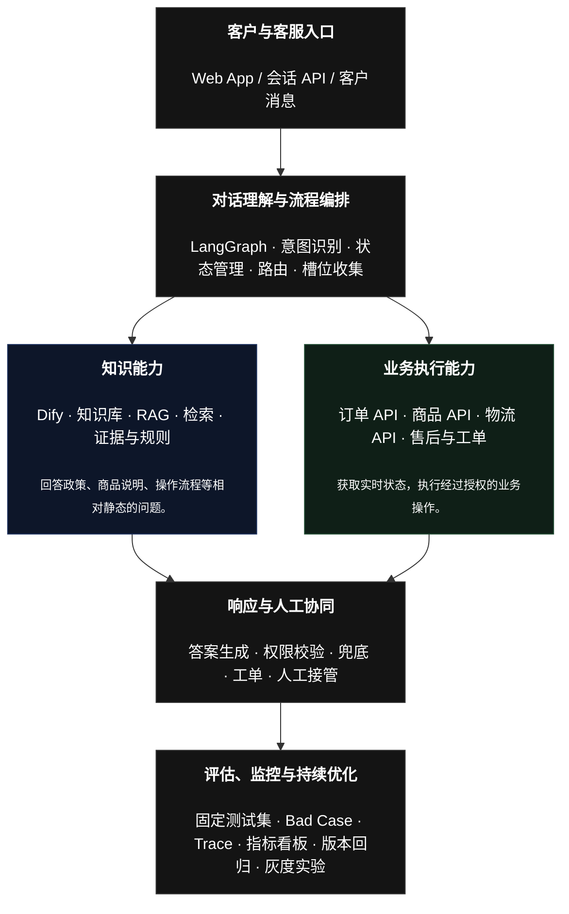
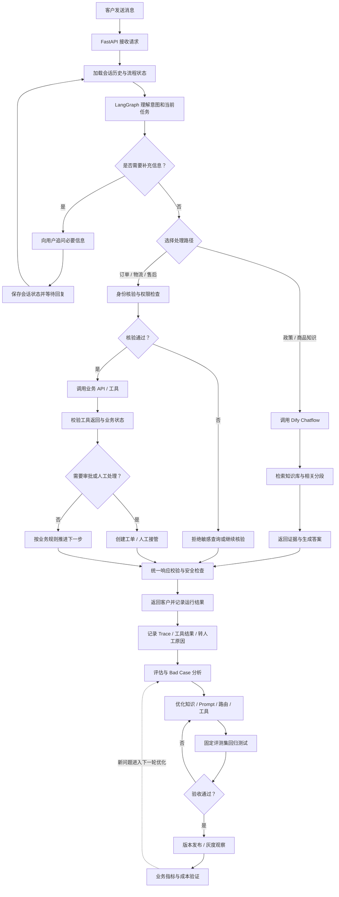

# 智能客户服务系统

本项目研究的，不只是“客服机器人怎么回答问题”，而是类似晓多、飞鸽、乐言的系统，完成以下完整闭环：

1. 接待与理解： 识别意图、商品、订单和客户诉求。
2. 知识与决策： 检索商品资料、理解售后政策、判断能否自动处理。
3. 业务执行： 调用订单、物流、库存、退款等系统。
4. 风险控制： 处理低置信度、投诉、越权、失败重试和人工接管。
5. 运营评估： 统计机器人解决率、转人工率、回答准确率、客户满意度、响应时延与单次会话成本。
6. 持续优化： 从未解决会话和人工纠正中发现知识缺口、流程缺陷与模型 Bad Case，再更新知识库、规则和 Prompt。

## 技术栈选择

| 组件     | 本指南选择                   | 用途               |
| ------ | ----------------------- | ---------------- |
| 编排框架   | Dify + LangGraph        | 节点、分支、循环、状态和人工审核 |
| 编程语言   | Python 3.11+            | 业务逻辑与工具开发        |
| 依赖管理   | `uv`                    | 创建环境、安装依赖        |
| 大模型    | 任意支持工具调用或结构化输出的兼容模型     | 理解客户意图、生成回复      |
| 业务数据   | Python 模拟数据，后续替换数据库/API | 订单、商品、退款规则       |
| Web 服务 | FastAPI                 | 把客服流程暴露成 API     |
| 测试     | pytest                  | 检查路由、业务规则、回复质量   |
| 生产观测   | 日志 + LangSmith 等追踪工具    | 调试节点、耗时、模型调用和异常  |


**当前项目结构**:
```
AICustomerService/
├── .env.example              # 环境变量模板；真实 .env 仅本地保留、不入库
├── .gitignore
├── .python-version           # Python 版本锁定
├── CLAUDE.md                 # 项目说明与文档维护规范
├── README.md
├── main.py                   # CLI 入口，便于本地冒烟
├── pyproject.toml
├── uv.lock
├── docs/
│   ├── PROJECT_STATUS.md         # 当前状态与下一步
│   ├── PROJECT_GAP_ANALYSIS.md   # 与行业标杆的差距分析
│   ├── roadmap/                  # V1–V8 路线图与各阶段验收标准
│   │   ├── MILESTONES.md
│   │   └── V1_BASELINE.md ~ V8_BUSINESS_ROI.md
│   └── runbooks/
│       └── SOP-dify-integration.md   # Dify 接入 SOP
├── ecommerce_cs_mvp_dataset/
│   └── ecommerce_cs_mvp_kit/     # 星桥优选合成客服基准包 xq-cs-benchmark-1.0
│       ├── README.md             # 数据包说明与 V1–V8 用法
│       ├── SOURCES.md            # 公开真实语料来源与使用边界
│       ├── data/
│       │   ├── eval_dataset.jsonl    # 50 条标准评测集（程序评估主文件）
│       │   ├── eval_dataset.csv      # 人工审阅版
│       │   ├── evaluation_rubric.md  # 评估口径
│       │   └── manifest.json         # 数据集版本与分布统计
│       ├── knowledge_base/           # 建议导入 Dify 的 6 份知识文档
│       │   ├── 00_商家与知识库说明.md
│       │   ├── 01_退换货与退款政策.md
│       │   ├── 02_订单物流与隐私流程.md
│       │   ├── 03_商品目录与属性.md
│       │   ├── 04_优惠券支付与发票.md
│       │   └── 05_客服SOP与转人工.md
│       ├── mock_api/                 # V3 只读工具的数据源
│       │   ├── merchant_policy.json  # 统一规则的结构化源文件
│       │   ├── orders.json           # 演示订单（含测试验证码）
│       │   ├── products.json         # 商品 / SKU / 库存
│       │   └── tracking.json         # 演示物流
│       └── reports/                  # 基线与回归测试结果（当前为空）
├── src/
│   └── customer_service/
│       ├── __init__.py
│       ├── state.py          # 流程共享状态
│       ├── tools.py          # 订单、商品、退款等业务工具（当前为 mock）
│       ├── dify_client.py    # Dify Chatflow API 客户端
│       ├── nodes.py          # 意图识别与各业务节点
│       ├── graph.py          # 工作流定义与编译
│       └── api.py            # FastAPI 服务入口
└── tests/
    ├── test_dify_client.py    # Dify 客户端（超时/重试/错误分类）
    ├── test_knowledge_node.py # knowledge 节点
    ├── test_graph_routing.py  # 图路由
    ├── test_intent_routing.py # 意图规则
    └── test_api.py            # FastAPI 接口
```

> `ecommerce_cs_mvp_dataset/` 是 V2 评测与 V3 工具接入的基准数据包：50 条 case 覆盖 FAQ、例外、多轮、工具调用、安全等场景；`knowledge_base/` 是 Dify 导入源，`mock_api/` 是业务工具的数据源。数据为人工设计的合成数据，使用边界见包内 `SOURCES.md`。

# 下一步：从演示 Bot 进化为 AI 客服解决方案

> 渐进式交付策略:我建议将项目拆为八个阶段。先让每一阶段都可运行、可测试，再向下一阶段推进。以下八个阶段不是八个必须独立部署的产品，它们是八个可验收的工程里程碑。先完成 V1～V4 的完整闭环，再把 V5～V8 做到可信的演示和验证。

完整系统分层


注:这是逻辑架构图，不代表每个请求都必须经过所有模块。简单 FAQ 可以直接走知识问答；订单查询则需要经过核验和业务工具。

**项目主线与数据流动图**：


读这张图时，重点关注四条线

- 第一条：请求与响应线。 客户消息如何进入系统，最后如何得到答复。这是服务入口和出口。
- 第二条：知识检索线。 问题如何变成检索请求，Dify 如何找到相关知识，回答依据是什么。这是 V1–V2 的核心。
- 第三条：业务执行线。 系统什么时候调用订单、物流或售后工具，什么时候需要核验、审批或转人工。这是 V3–V6 的核心。
- 第四条：质量反馈线。 每次运行留下什么证据，如何分析失败，修改之后如何回归测试，最终如何发布和验证业务效果。这是 V2、V7、V8 的核心，也是持续改进的关键。

注意：图中的业务 API 不是由 RAG 代替的，评估也不是每次都必须让另一个 LLM 打分。可以使用确定性规则、标准答案比对、人工复核和模型辅助评估的组合。

**可能的v1-v8的完整项目结构**(仅供参考,根据项目推进和业务需求演进按需调整)

```
AICustomerService/
├── .env.example
├── .gitignore
├── .python-version
├── CLAUDE.md
├── README.md
├── pyproject.toml
├── uv.lock
│
├── configs/
│   ├── app.yaml
│   ├── retrieval.yaml
│   ├── evaluation.yaml
│   └── safety.yaml
│
├── docs/
│   ├── ARCHITECTURE.md
│   ├── PROJECT_STATUS.md
│   ├── PROJECT_GAP_ANALYSIS.md
│   ├── DATA_DICTIONARY.md
│   ├── API_CONTRACTS.md
│   ├── roadmap/
│   │   ├── MILESTONES.md
│   │   └── V1~V8 各阶段执行与验收文档
│   └── runbooks/
│       ├── SOP-dify-integration.md
│       └── RELEASE_RUNBOOK.md
│
├── ecommerce_cs_mvp_dataset/
│   └── ecommerce_cs_mvp_kit/
│       ├── README.md
│       ├── SOURCES.md
│       ├── data/
│       ├── knowledge_base/
│       ├── mock_api/
│       └── reports/
│
├── src/
│   └── customer_service/
│       ├── __init__.py
│       ├── main.py
│       │
│       ├── api/
│       │   ├── app.py
│       │   ├── routes.py
│       │   ├── schemas.py
│       │   └── middleware.py
│       │
│       ├── orchestration/
│       │   ├── state.py
│       │   ├── nodes.py
│       │   ├── graph.py
│       │   ├── routing.py
│       │   └── checkpoints.py
│       │
│       ├── knowledge/
│       │   ├── dify_client.py
│       │   ├── retrieval.py
│       │   ├── evidence.py
│       │   └── versioning.py
│       │
│       ├── tools/
│       │   ├── products.py
│       │   ├── orders.py
│       │   ├── logistics.py
│       │   ├── after_sales.py
│       │   └── tickets.py
│       │
│       ├── services/
│       │   ├── identity.py
│       │   ├── policy_engine.py
│       │   ├── handoff.py
│       │   └── response_guard.py
│       │
│       ├── integrations/
│       │   ├── dify.py
│       │   └── mock_backend.py
│       │
│       ├── observability/
│       │   ├── logging.py
│       │   ├── tracing.py
│       │   └── metrics.py
│       │
│       └── evaluation/
│           ├── dataset.py
│           ├── runner.py
│           ├── evaluators.py
│           ├── bad_cases.py
│           └── reports.py
│
├── scripts/
│   ├── run_smoke_test.py
│   ├── run_evaluation.py
│   ├── compare_retrieval.py
│   └── generate_report.py
│
├── tests/
│   ├── unit/
│   ├── integration/
│   ├── evaluation/
│   ├── safety/
│   └── e2e/
│
├── migrations/
│
└── reports/
    ├── baseline/
    ├── regression/
    └── experiments/
```

这些目录分别解决什么问题？

|目录|主要职责|对应阶段|
|---|---|---|
|`api/`|接收请求、参数校验、返回响应|V1、V5|
|`orchestration/`|维护流程状态、节点路由、任务恢复|V1、V4、V5|
|`knowledge/`|Dify 调用、检索证据、知识版本|V1、V2|
|`tools/`|订单、物流、商品、售后业务接口|V3|
|`services/`|身份核验、规则判断、人工交接、安全检查|V4–V6|
|`integrations/`|对接 Dify、模拟后端或未来真实系统|V1、V3|
|`observability/`|运行日志、Trace、系统和业务指标|V7|
|`evaluation/`|测试集运行、评分、失败归因和报告|V2、V7、V8|
|`configs/`|管理可调整的运行参数和实验配置|V2、V6、V7|
|`tests/`|单元、集成、回归、安全和端到端测试|V1–V8|

几个架构上的提醒：
- 现有的 src/customer_service/state.py、nodes.py、graph.py 不需要立即迁移；等文件确实变得复杂时，再拆出 orchestration/。
- dify_client.py 是调用外部 Dify 服务的客户端；knowledge/ 则是知识检索的业务封装。当前规模较小时，可以继续放在原有结构里。
- mock_api/ 是模拟业务数据源，不等于生产 API 服务。V3 可以在它外面增加 FastAPI 模拟后端。
- migrations/ 只有在引入数据库表结构版本管理时才需要。
- reports/ 应保存可追溯的评估结果，不应只保存截图。原始运行结果、配置和汇总指标最好可以关联起来。

V7 需要额外注意：状态不等于日志

LangGraph 的状态用于保存当前对话和任务的执行上下文；生产环境需要持久化时，可以使用 checkpointer 保存执行检查点。它能支持多轮对话延续、失败恢复和等待人工输入后继续执行。但业务审计日志、指标和 Trace 是另一回事。它们用于回答：
- 谁发起了什么请求？
- 系统调用了什么工具，使用了什么参数？
- 工具返回了什么结果？
- 哪一步耗时过长或失败？
- 用户最终得到什么响应？

不要把这些所有数据都塞进一个不断膨胀的 LangGraph State 中。