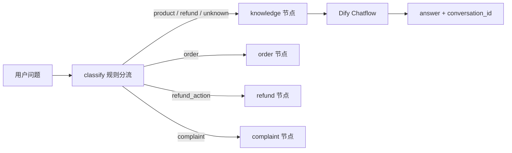

# SOP：在 LangGraph 中接入 Dify 知识问答节点

> 版本：v1.0（2026-10-25）  
> 适用阶段：V1 知识问答基线 → V4 LangGraph 任务编排  
> 目标：让 Dify 负责知识问答，让 LangGraph 负责业务操作与状态流转。

---

## 1. 这份 SOP 解决什么问题

Dify 上已经部署好 `AICustomerService` Chatflow（RAG、Question Classifier、Knowledge Retrieval、LLM 等节点）。现在需要让 LangGraph 在合适的时机调用它，而不是把所有问题都塞给同一个流程。

本文记录四件事：

1. 哪些问题应该交给 Dify，哪些应该留在 LangGraph；
2. 调用 Dify 的参数、返回值和多轮会话怎么处理；
3. 失败时如何降级，避免异常穿透整个客服流程；
4. 如何复现和验证这次接入。

---

## 2. 分工与路由决策

| 问题类型 | 示例 | 处理方 |
| --- | --- | --- |
| 商品、FAQ、退款政策、发货政策 | 退款多久到账？ | Dify `knowledge` 节点 |
| 实时订单 / 物流 | 我的订单到哪了？ | LangGraph `order` 节点 |
| 明确的退款 / 退货操作 | 我要申请退款 | LangGraph `refund` 节点（当前为模拟规则，V3/V4 接真实 API） |
| 投诉 / 转人工 | 我要投诉 | LangGraph `complaint` 节点 |



关键区分：

- `refund` 表示“问退款规则”，走 Dify；
- `refund_action` 表示“要执行退款/退货”，走 LangGraph 业务节点；
- 当前规则只是 V1 的过渡方案，V2/V4 应替换为大模型结构化意图识别。

---

## 3. Dify 应用前提

本次接入前先确认了应用类型：

```bash
set -a && . ./.env && set +a
curl -sS -H "Authorization: Bearer $DIFY_API_KEY" "$DIFY_API_URL/info"
```

返回：

```json
{"name":"AICustomerService","mode":"advanced-chat",...}
```

`advanced-chat` 即 Chatflow，使用 `POST /chat-messages`。如果是 Workflow 类型应用，则应改用 `POST /workflows/run`。

注意：

- 使用的是 Dify **应用 API Key**（通常以 `app-` 开头），不是知识库 API Key；
- 当前应用输入表单为空，因此 `inputs` 传 `{}`；
- 当前应用未开启“引用与归属”（retriever resource），所以返回的 `metadata.retriever_resources` 为空。如果后续需要展示知识来源，在 Dify 应用设置中开启即可，代码已经能解析该字段。

---

## 4. 配置项

`.env` 中新增：

```dotenv
DIFY_API_KEY=app-xxxxxxxx
DIFY_API_URL=https://api.dify.ai/v1

DIFY_TIMEOUT_SECONDS=30
DIFY_MAX_RETRIES=1
DIFY_RETRY_BACKOFF_SECONDS=1
DIFY_RETRY_ON_TIMEOUT=false
```

| 变量 | 默认值 | 说明 |
| --- | --- | --- |
| `DIFY_API_KEY` | 必填 | Dify 应用 API Key |
| `DIFY_API_URL` | 必填 | 例如 `https://api.dify.ai/v1`，末尾斜杠会自动去掉 |
| `DIFY_TIMEOUT_SECONDS` | `30` | 单次 HTTP 请求超时；实测一次问答约 11～13 秒 |
| `DIFY_MAX_RETRIES` | `1` | 总尝试次数 = `MAX_RETRIES + 1` |
| `DIFY_RETRY_BACKOFF_SECONDS` | `1` | 指数退避基数：1s、2s、4s…… |
| `DIFY_RETRY_ON_TIMEOUT` | `false` | 是否重试读超时；默认关闭，避免 Dify 侧产生重复消息 |

仓库新增了 `.env.example`，`.env` 仍由 `.gitignore` 忽略。不要把真实 Key 写进文档或提交记录。

---

## 5. 代码改动清单

| 文件 | 改动 |
| --- | --- |
| `src/customer_service/dify_client.py` | 新增 Dify 配置、HTTP 客户端、响应模型、错误分类与重试 |
| `src/customer_service/state.py` | 新增 `dify_inputs`、`dify_conversation_id`、`dify_message_id`、`dify_result`、`dify_error`；意图增加 `refund_action` |
| `src/customer_service/nodes.py` | 新增 `knowledge_node`；细化 `classify_intent` 的知识/操作分流 |
| `src/customer_service/graph.py` | 注册 `knowledge` 节点；新增 `use_dify` 开关，可回退到本地模拟节点 |
| `src/customer_service/api.py` | 新增 `POST /chat`、`GET /health`，支持 `conversation_id` 透传 |
| `main.py` | 改成可用命令行参数运行的冒烟测试入口 |
| `tests/` | 新增客户端、节点、路由、API 测试，共 41 项 |
| `.env.example` | Dify 配置模板 |

---

## 6. 关键实现说明

### 6.1 请求体

```json
{
  "query": "退款多久到账？",
  "inputs": {},
  "response_mode": "blocking",
  "user": "user_001",
  "conversation_id": "上一轮返回的 ID，可为空",
  "auto_generate_name": true
}
```

- `response_mode` 选 `blocking`：LangGraph 节点需要同步拿到最终答案，实现最简单。流式输出留给后续 Web 工作台阶段。
- `user` 使用业务侧的 `user_id`，保证 Dify 侧会话归属清晰。
- `conversation_id` 为空时 Dify 会新建会话；后续必须原样带回。

### 6.2 返回值

客户端把 Dify 响应归一化为 `DifyChatResult`：

| 字段 | 用途 |
| --- | --- |
| `answer` | 最终回复 |
| `conversation_id` | 下一轮多轮对话必须带回 |
| `message_id` | 后续做反馈、审计、Bad Case 定位 |
| `usage` | token 消耗与耗时，用于成本统计 |
| `retriever_resources` | 知识来源；当前 Dify 应用未开启，可能为空 |
| `latency_ms` | 客户端侧实际耗时 |

### 6.3 State 字段

```python
dify_inputs: dict
dify_conversation_id: str
dify_message_id: str
dify_result: dict
dify_error: str
```

`answer` 仍然是最终对外回复字段，Dify 的原始信息放在 `dify_result`，避免污染业务字段。

### 6.4 失败与降级

| 情况 | 行为 | `handoff_reason` |
| --- | --- | --- |
| Dify 返回 4xx（如 401/400） | 转人工 | `dify_api` |
| 请求超时 | 转人工 | `dify_timeout` |
| 连接失败 | 转人工 | `dify_connection` |
| 配置缺失（Key/URL 未设置） | 转人工 | `dify_configuration` |
| 返回格式异常（非 JSON / 缺 answer） | 转人工 | `dify_response` |
| 返回空答案 | 转人工 | `dify_empty_answer` |
| 未预期异常 | 转人工 | `dify_unexpected_error` |

重试策略：

- 自动重试：HTTP `429`、`500`、`502`、`503`、`504`，以及连接错误；
- 默认不重试读超时：一次超时后 Dify 可能已经处理完消息，盲目重试会制造重复问答；
- 如果业务可以接受重复风险，设置 `DIFY_RETRY_ON_TIMEOUT=true`。

### 6.5 多轮会话

```text
第 1 轮：conversation_id 为空 → Dify 返回 conv-A
         LangGraph 把 conv-A 写入 state
第 2 轮：把 conv-A 作为 conversation_id 传入 → Dify 保留上下文
```

API 和 CLI 都支持把上一轮返回的 `conversation_id` 再传进来。实测第二轮能够正确继承“退款”上下文。

### 6.6 规则分流示例

| 用户问题 | 识别意图 | 实际路由 |
| --- | --- | --- |
| 退款多久到账？ | `refund` | Dify |
| 我要申请退款 | `refund_action` | LangGraph 退款节点 |
| 我的订单到哪了？ | `order` | LangGraph 订单节点 |
| 下单后多久发货？ | `unknown` | Dify |
| 发货了吗？ | `order` | LangGraph 订单节点 |

---

## 7. 复现步骤

### 7.1 安装依赖

```bash
uv sync
```

### 7.2 配置环境变量

```bash
cp .env.example .env
# 编辑 .env，填入真实的 DIFY_API_KEY / DIFY_API_URL
```

### 7.3 验证 Dify 连通性

```bash
set -a && . ./.env && set +a
curl -sS -H "Authorization: Bearer $DIFY_API_KEY" "$DIFY_API_URL/info"
```

### 7.4 命令行冒烟测试

```bash
# 知识问题 → Dify
uv run python main.py "退款多久到账？"

# 多轮：把上一条输出的 conversation_id 作为第二个参数
uv run python main.py "那需要等多久？" "<conversation_id>"

# 业务操作 → LangGraph，不调用 Dify
uv run python main.py "我要申请退款"
```

### 7.5 运行测试

```bash
uv run pytest -q
```

### 7.6 启动 API

```bash
uv run uvicorn src.customer_service.api:app --reload --port 8000
```

```bash
curl -sS http://127.0.0.1:8000/chat \
  -H 'Content-Type: application/json' \
  -d '{"user_id":"user_001","question":"退款多久到账？"}'
```

第二轮把响应里的 `conversation_id` 再传回去：

```bash
curl -sS http://127.0.0.1:8000/chat \
  -H 'Content-Type: application/json' \
  -d '{"user_id":"user_001","question":"那需要等多久？","conversation_id":"<上轮返回值>"}'
```

---

## 8. 本次实测记录（2026-10-25）

| 验证项 | 结果 |
| --- | --- |
| `GET /info` | `mode=advanced-chat`，应用类型正确 |
| 第一轮真实问答 | HTTP 200，`intent=refund`，Dify 正常回答，未转人工，耗时约 12.5s |
| 第二轮多轮问答 | 使用上轮 `conversation_id`，回答沿用退款上下文，耗时约 11.3s |
| 退款操作 | `intent=refund_action`，走 LangGraph，未调用 Dify，正确转人工 |
| 单元测试 | `41 passed` |

耗时是当前网络 + Dify LLM/RAG 的实测值，不应直接当作生产 SLA；上线前应基于自己的部署环境和模型重新压测。

---

## 9. 常见问题排查

| 现象 | 可能原因 | 处理 |
| --- | --- | --- |
| 401 `unauthorized` | Key 错误或用了知识库 Key | 换成 Dify 应用 API Key |
| 400 `invalid_param` | `inputs` 与 Dify 输入表单不匹配，或 `query` 为空 | 当前应用 `inputs={}`；后续增加变量时同步修改 |
| 404 | `DIFY_API_URL` 写错，或应用类型不是 Chatflow | 确认以 `/v1` 结尾；Workflow 应用改用 `/workflows/run` |
| 请求超时 | RAG/LLM 响应慢 | 调大 `DIFY_TIMEOUT_SECONDS`，或优化 Dify 工作流 |
| `retriever_resources` 为空 | Dify 应用未开启引用与归属 | 在 Dify 应用设置中开启 |
| 明明配了 Dify 却没被调用 | 被规则分到了订单/退款操作节点 | 看第 6.6 节路由示例，检查 `classify_intent` |
| 多轮丢上下文 | 没把 `conversation_id` 传回来 | 从 state / API 响应中取出并透传 |
| 出现重复消息 | 超时后自动重试 | 保持 `DIFY_RETRY_ON_TIMEOUT=false`，或后续引入幂等键 |

---

## 10. 已知限制与后续钩子

当前版本刻意保持小而可运行，以下能力留给后续阶段：

1. **流式输出**：目前是 blocking；V5 工作台可以基于 SSE 增加 `chat_stream`，改善首字延迟。
2. **鉴权与租户隔离**：`/chat` 目前没有鉴权，属于 V6 范围。
3. **意图识别升级**：当前是规则分流；V2/V4 应换成大模型结构化输出，并纳入评测集。
4. **真实业务工具**：`order` / `refund` 仍是模拟数据；V3 接订单、物流、售后 API。
5. **知识来源展示**：Dify 侧开启引用后，可直接把 `retriever_resources` 返回给前端。
6. **反馈闭环**：`message_id` 已保存，后续可以接 Dify 的消息反馈、Bad Case 表和回归测试。
7. **Dify inputs/files**：客户端已支持 `inputs` 与 `files` 参数，等应用增加表单或文件上传后直接使用。
8. **离线模式**：`build_graph(use_dify=False)` 保留本地模拟节点，便于无网络演示和测试。
9. **异步与并发**：当前节点使用同步 HTTP；高并发 Web 场景可改为 `httpx.AsyncClient` + 异步节点，避免占用工作线程。

---

## 11. 参考资料

- Dify Chatflow 指南：<https://docs.dify.ai/en/api-reference/guides/chatflow>
- Dify Chat Messages API：<https://docs.dify.ai/en/api-reference/chat/chat-messages>
- 项目内实现：`src/customer_service/dify_client.py`、`src/customer_service/nodes.py`
