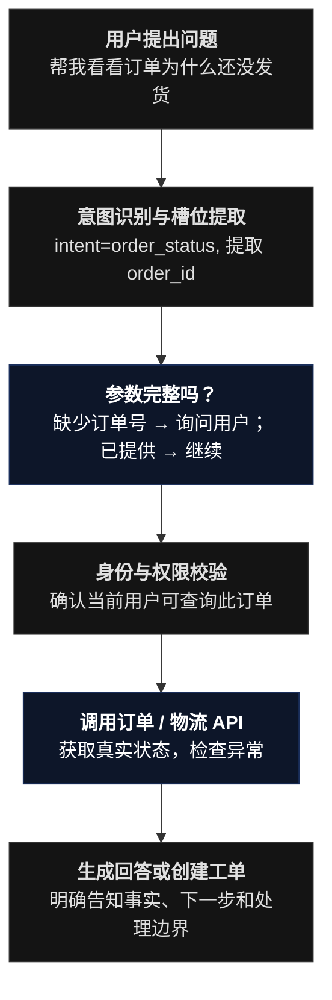

# V4：LangGraph 任务编排 & 构建有状态的智能客服 Agent

## 目标

复杂任务编排、意图路由、状态管理、槽位收集、工具调用、错误重试、流程恢复、人工接管和跨系统协作。从固定问答流程，升级为可处理多步骤任务的对话引擎

为什么不一直用 Dify？

Dify 已经能完成很多工作流。但当你的客服任务需要记住多个槽位、跨多个 API、等待用户补充信息、暂停等待人工批准、失败后恢复时，LangGraph 能提供更直接的代码级控制。

这也是它的核心价值：状态持久化、线程管理、人工中断和恢复，而不仅仅是“多一个 Agent 框架”。

## V4.1 先设计确定性流程，再引入 Agent



这里的意图识别可以由 LLM 辅助，但权限判断、参数验证、退款资格和状态迁移都应该使用确定性代码或权威业务系统。

## V4.2 定义 Agent 状态

不要只把聊天历史当作状态。一个能办事的客服 Agent，应该显式保存任务进度。

```python
from typing import Literal, TypedDict


class CustomerServiceState(TypedDict, total=False):
    user_id: str
    conversation_id: str
    user_query: str

    intent: str
    order_id: str | None

    auth_status: Literal[
        "unknown", "verified", "denied"
    ]

    tool_result: dict | None
    retrieved_context: str
    response: str

    needs_human: bool
    error_code: str | None
```

这里每个字段都有业务意义：

- `intent`：当前处理哪一类问题。
- `order_id`：是否已经拿到必要参数。
- `auth_status`：是否有权查询。
- `tool_result`：业务系统的真实结果。
- `needs_human`：是否需要转人工。
- `error_code`：流程失败的具体原因。

不要把敏感凭据、密码或完整支付信息放进长期对话状态。

## V4.3 构建第一个 LangGraph

下面先搭建一个可以运行的最小状态图：意图路由 → 订单查询 → 回答。它暂时不调用 LLM 做意图识别，而是用确定性规则验证编排机制。

创建 `app/customer_service_graph.py`：

```python

from typing import TypedDict
from langgraph.graph import StateGraph, START, END


class State(TypedDict, total=False):
    query: str
    intent: str
    response: str
    needs_human: bool


def classify(state: State) -> dict:
    query = state["query"]

    if "订单" in query or "物流" in query:
        return {"intent": "order"}
    if "退款" in query or "退货" in query:
        return {"intent": "after_sales"}

    return {"intent": "knowledge"}


def route(state: State) -> str:
    return state["intent"]


def order_node(state: State) -> dict:
    # 后续替换为真实的业务 API 工具调用。
    return {
        "response": "订单查询流程已触发。下一步需要提取订单号并完成身份校验。",
        "needs_human": False,
    }


def after_sales_node(state: State) -> dict:
    return {
        "response": "我会先核对售后规则；涉及实际退款操作时需要额外授权。",
        "needs_human": False,
    }


def knowledge_node(state: State) -> dict:
    return {
        "response": "该问题进入知识库问答流程。",
        "needs_human": False,
    }


builder = StateGraph(State)

builder.add_node("classify", classify)
builder.add_node("order", order_node)
builder.add_node("after_sales", after_sales_node)
builder.add_node("knowledge", knowledge_node)

builder.add_edge(START, "classify")

builder.add_conditional_edges(
    "classify",
    route,
    {
        "order": "order",
        "after_sales": "after_sales",
        "knowledge": "knowledge",
    },
)

builder.add_edge("order", END)
builder.add_edge("after_sales", END)
builder.add_edge("knowledge", END)

graph = builder.compile()


if __name__ == "__main__":
    result = graph.invoke({"query": "帮我查询订单物流"})
    print(result)
```

运行：

```bash
uv run python app/customer_service_graph.py
```

你应该能看到任务被路由到订单分支。

这只是第一张状态图，尚未接入 Dify，也不是真正的订单查询 Agent。下一步将 `order_node` 替换成 V3 的业务工具，并在 `knowledge_node` 中调用 Dify 知识库应用。

## V4.4 让 LangGraph 调用 Dify 知识库

建议将 Dify 保留为独立的 RAG 服务。LangGraph 负责任务编排，遇到政策类问题时请求 Dify 的 Chat API。

先在 Dify 应用的 API Access 页面创建应用 API Key，放入本地环境变量，而不是写进源代码。

```
export DIFY_BASE_URL="https://api.dify.ai/v1"
export DIFY_API_KEY="替换为你自己的应用密钥"
```

创建 `app/dify_client.py`：
```python

import os
import httpx


async def ask_dify(
    query: str,
    user_id: str,
    conversation_id: str | None = None,
) -> dict:
    base_url = os.environ["DIFY_BASE_URL"].rstrip("/")
    api_key = os.environ["DIFY_API_KEY"]

    payload = {
        "inputs": {},
        "query": query,
        "response_mode": "blocking",
        "user": user_id,
    }

    if conversation_id:
        payload["conversation_id"] = conversation_id

    async with httpx.AsyncClient(timeout=30.0) as client:
        response = await client.post(
            f"{base_url}/chat-messages",
            headers={
                "Authorization": f"Bearer {api_key}",
                "Content-Type": "application/json",
            },
            json=payload,
        )
        response.raise_for_status()
        return response.json()
```

这里使用 Dify 的 Chat Messages API。实际部署时请以你自己的 Dify 实例的 API 文档为准，尤其要确认应用类型、认证方式、请求字段和返回结构。

调用返回值后，需要从响应中提取 `answer`、`conversation_id` 和可用的引用信息，并记录请求耗时、状态码及错误信息。

在 LangGraph 中，可以让 `knowledge_node` 调用 `ask_dify()`，再把结果存入状态。

注意：如果你的当前 LangGraph 图是同步执行的，不能直接在同步节点里随意调用异步函数；可以选择统一使用异步图执行，或把 HTTP 客户端封装成同步工具。

### 一个重要的架构边界

不要构建下面这种没有明确边界的循环：

```
Dify → LangGraph → Dify → LangGraph → ...
```

应该有一个清晰的编排主控：

- 客户请求进入 LangGraph：由它负责意图路由、业务任务状态和工具调用；Dify 作为知识检索服务。
- 或者客户请求进入 Dify：由 Dify 负责简单流程，复杂任务再调用 LangGraph 服务。

两种架构都可以。对于你想深入学习有状态 Agent、业务 API、人工审批的目标，我更推荐第一种作为 V4 的最终形态；但不要在 V1/V2 阶段就重写现有 Dify 应用。

## V4.5 接入真正的工具调用

把订单工具封装为 LangChain Tool，交给 LangGraph 中的工具执行节点。

下面是最小示例。它假设你的 FastAPI 服务已经运行，并且只使用演示用户身份。

```python
import os
import httpx

from langchain_core.tools import tool


@tool
def get_order(order_id: str, user_id: str) -> dict:
    """查询当前已验证用户有权访问的订单状态。

    order_id: 订单编号
    user_id: 本地演示用户 ID。生产环境不得由模型决定。
    """
    base_url = os.getenv(
        "BUSINESS_API_URL",
        "http://127.0.0.1:8000",
    )

    response = httpx.post(
        f"{base_url}/tools/get_order",
        json={"order_id": order_id},
        headers={"X-Demo-User-Id": user_id},
        timeout=5.0,
    )

    response.raise_for_status()
    return response.json()
```

这里有一个必须认真对待的设计问题：`user_id` 不应该由模型自由决定。在真实系统中，应当由经过身份验证的服务端会话提供身份，并在业务 API 内完成授权校验。这个示例只用于展示工具封装方式。

下一步，你可以把工具接入 `ToolNode`，让图根据已经确定的意图调用对应工具。建议初期只开放只读工具，不要让 Agent 拥有任意 HTTP 请求、任意 SQL 或不受限制的代码执行权限。

## V4.6 增加多轮槽位收集

真实客服任务经常缺少必要参数。

例如：
- 用户：帮我查一下订单。
- Bot：请提供订单号，或从已验证的订单列表中选择一个订单。
- 用户：ORD100001。
- Bot：查询订单 API，验证权限后返回真实状态。

你需要显式处理“信息缺失”：

```
收到用户请求
    ↓
识别 intent=order_lookup
    ↓
检查 order_id 是否存在
    ├─ 否 → 保存当前任务状态 → 询问订单号
    └─ 是 → 校验用户身份与订单权限
                  ↓
               调用 API
                  ↓
               返回结果
```

不要仅靠把所有聊天记录塞给模型，期待它每次都正确恢复业务状态。应将必要参数存入状态对象，并在每次继续执行前验证其完整性。

## V4.7 增加持久化、暂停和人工审批

当你需要让 Agent 暂停等待人工批准时，LangGraph 的 `interrupt()` 和 Checkpointer 就很有价值。流程中断后，可以通过相同的 `thread_id` 恢复执行。

建议先设计三种执行级别：

|级别|例子|执行方式|
|---|---|---|
|L0 只读|查订单、查物流|完成身份校验后自动执行|
|L1 低风险写入|创建客服工单|校验必需字段、幂等键及写入权限|
|L2 高风险操作|实际退款、修改重要账户信息|业务规则校验、明确授权、必要时人工审批|

对于退款流程，至少应拆为：

```
识别退款诉求
  ↓
查询订单与售后资格
  ↓
生成退款申请摘要
  ↓
向用户确认操作内容
  ↓
服务端校验权限与资格
  ↓
必要的人工审批
  ↓
执行退款 API
  ↓
验证实际执行结果
  ↓
返回结果并写入审计日志
```

注意，用户说“帮我退款”不等于已经完成全部必要授权。授权要和具体订单、金额、操作类型及业务规则绑定。

持久化方面：
- 本地学习阶段：可以先用内存 Checkpointer。
- 多次重启仍需保留任务状态时：使用持久化 Checkpointer，例如 PostgreSQL 方案。
- 生产环境：还要考虑线程隔离、保留周期、访问控制和故障恢复。

### V4 验收标准

- 至少实现三条不同的客服业务路径。
- 能处理参数缺失、API 失败、权限拒绝和多轮补充信息。
- 只读工具与写入工具有明确权限边界。
- 高风险任务能够暂停、审批和恢复。
- 所有工具调用都能定位到对应会话、输入、结果和耗时。
- 模型无法凭空宣称业务操作已经成功。